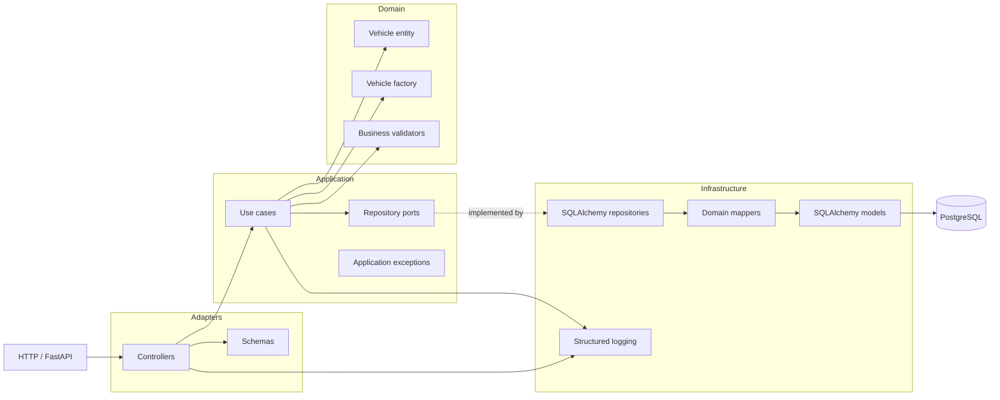
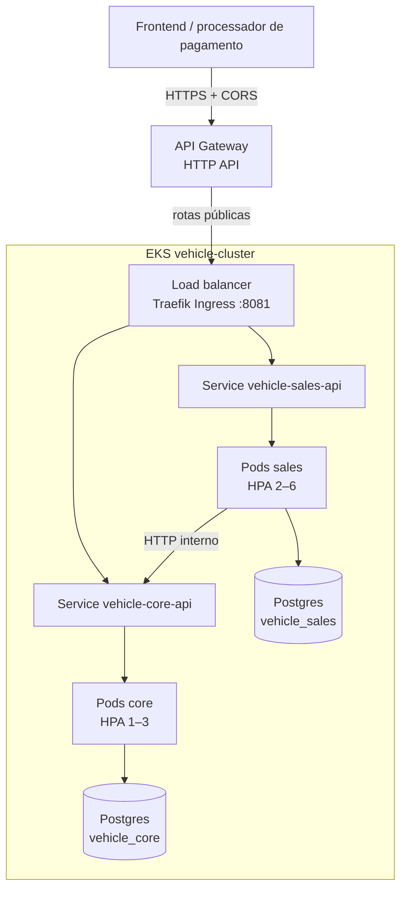
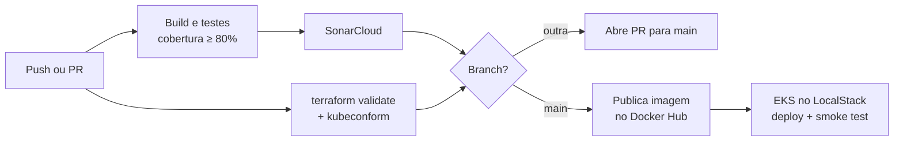

[](https://sonarcloud.io/summary/new_code?id=nessaoana_vehicle-core) [](https://sonarcloud.io/summary/new_code?id=nessaoana_vehicle-core)

# vehicle-core

Serviço principal para cadastro de veículos e operações de negócio. A imagem da
API é construída a partir de `app/`, e a stack local fornece PostgreSQL e
LocalStack.

## Arquitetura em camadas



As dependências apontam para dentro: o domínio não depende de FastAPI,
SQLAlchemy ou PostgreSQL. A infraestrutura implementa as portas definidas pela
camada de aplicação.

## Desenvolvimento local

Crie os arquivos de ambiente locais a partir de `.env.example` e execute:

```bash
python3 -m venv .venv
.venv/bin/pip install -r app/src/requirements.txt
PYTHONPATH=app .venv/bin/pytest app/tests --cov=app/src --cov-report=term-missing --cov-fail-under=80
docker compose up --build
```

Para executar a API localmente pelo terminal, use o pacote `src` como módulo:

```bash
PYTHONPATH=app .venv/bin/python -m uvicorn src.main:app \
	--host 127.0.0.1 --port 8081 --reload
```

No VS Code, selecione a configuração `Run vehicle-core API` em **Run and Debug**.
Ela executa a API na porta `8081`. Não use **Run Python File** diretamente no
arquivo `app/src/main.py`, pois os imports da aplicação usam o pacote `src`.

O container da API escuta na porta `8001`, a execução local usa `8081`, e o PostgreSQL é exposto na porta
`5433` para evitar conflitos com o serviço de venda de veículos.

## Cadastro de veículo

Com a API local em execução, cadastre um veículo usando o endpoint `POST
/vehicles`:

```bash
curl -X POST http://127.0.0.1:8081/vehicles \
	-H 'Content-Type: application/json' \
	-d '{
		"license_plate": "ABC1D23",
		"brand": "Toyota",
		"model": "Corolla",
		"year": 2024,
		"price": "75000.00",
		"color": "Black",
		"notes": "Single owner"
	}'
```

O cadastro aceita placas brasileiras no formato antigo (`ABC-1234` ou
`ABC1234`) e no formato Mercosul (`ABC1D23`). Letras minúsculas, espaços e
hífens são normalizados. Placas inválidas retornam `422` e uma placa já
cadastrada retorna `409`.

Para consultar ou editar um veículo:

```bash
curl http://127.0.0.1:8081/vehicles/1

curl -X PATCH http://127.0.0.1:8081/vehicles/1 \
	-H 'Content-Type: application/json' \
	-d '{"price": "82000.00", "model": "Yaris"}'
```

Para pesquisar veículos, use `GET /vehicles`. O resultado vem ordenado por
preço, do mais barato para o mais caro, e todos os filtros são opcionais:
`status` (`available` ou `sold`), `brand`, `model` (busca parcial, sem
diferenciar maiúsculas) e o intervalo `min_year`/`max_year`:

```bash
curl 'http://127.0.0.1:8081/vehicles?status=available&brand=toyota&min_year=2020&max_year=2024'
```

O serviço de vendas pode atualizar a disponibilidade após a compra por meio do
endpoint interno:

```bash
curl -X PATCH http://127.0.0.1:8081/vehicles/1/availability \
	-H 'Content-Type: application/json' \
	-d '{"status": "sold", "active": false}'
```

Os endpoints de observabilidade são:

```text
GET /health       # processo disponível
GET /health/ready # processo e banco disponíveis
```

## Infraestrutura

Os dois serviços rodam num único cluster EKS emulado pelo LocalStack Pro. Cada
serviço tem seu próprio namespace e seu próprio PostgreSQL, e um API Gateway é
a única porta de entrada pública.



Este repositório é dono da infraestrutura compartilhada:

| Caminho | Conteúdo |
|---|---|
| [`infra/main.tf`](infra/main.tf) | VPC, subnets, IAM role e o cluster EKS `vehicle-cluster` |
| [`infra/gateway.tf`](infra/gateway.tf) | API Gateway com CORS, throttling e as rotas públicas |
| [`k8s/`](k8s/) | Namespace, Postgres (StatefulSet), Deployment, Service, HPA e Ingress do vehicle-core |
| [`scripts/`](scripts/) | Deploy, kubeconfig, smoke test e teste de carga |

### Rotas públicas

O API Gateway só expõe as rotas abaixo. A rota interna
`PATCH /vehicles/{id}/availability`, usada pelo vehicle-sales, e os health
checks não ficam acessíveis por ele.

| Rota | Serviço |
|---|---|
| `POST /vehicles`, `GET /vehicles`, `GET /vehicles/{id}`, `PATCH /vehicles/{id}` | vehicle-core |
| `GET /vehicles/available`, `GET /vehicles/sold` | vehicle-sales |
| `POST /sales`, `POST /payments/webhook` | vehicle-sales |

A URL base para o frontend sai de `make gateway-url`. As origens liberadas no
CORS ficam na variável `frontend_origins` do Terraform.

O vehicle-sales chama o vehicle-core direto pelo DNS do cluster
(`vehicle-core-api.vehicle-core.svc.cluster.local`), sem passar pelo gateway.

### Escalabilidade

- **API Gateway**: limita cada rota a 100 req/s, com rajadas de até 200.
- **Load balancer**: o Traefik distribui as requisições entre os Services. No
  EKS real, o mesmo Ingress seria atendido por um ALB.
- **HPA**: o vehicle-core escala de 1 a 3 pods (CPU 70%), e o vehicle-sales de
  2 a 6 (CPU 60% ou memória 75%), já que é ele quem recebe os picos de
  listagem e compra.

### Subindo o ambiente completo

Pré-requisitos: Docker, Terraform, AWS CLI, kubectl, kustomize, jq e um
`LOCALSTACK_AUTH_TOKEN` (LocalStack Pro) no `.env`. Com o repositório
`vehicle-sales` clonado ao lado deste:

```bash
make localstack   # sobe o LocalStack Pro
make cluster      # Terraform: EKS + API Gateway; configura o kubectl
make deploy-all   # publica vehicle-core e vehicle-sales
make smoke-test   # cadastro → compra → webhook → vendidos, pelo gateway
```

Para ver o autoscaling, rode `kubectl get hpa -A -w` num terminal e
`make load-test` em outro (requer `hey`).

O cluster não sobrevive a um restart do LocalStack. Depois de reiniciar, rode
`make cluster` e `make deploy-all` de novo.

## CI/CD



O CI roda em pushes para qualquer branch e em PRs para `main`:

- build e testes, com cobertura mínima de 80%;
- análise no SonarCloud, que bloqueia a alteração se o quality gate falhar;
- `terraform fmt` e `validate`, e validação dos manifestos com `kubeconform`.

Se o CI passar:

- **em outra branch**, um PR para `main` é aberto automaticamente;
- **na `main`**, o CD publica a imagem `vehicle-core:main-<sha>` no Docker Hub,
  sobe o LocalStack Pro no runner, cria o cluster e o API Gateway, publica o
  vehicle-core (nova imagem) e o vehicle-sales (`:main`) e roda o smoke test
  pelo gateway.

Configuração no GitHub:

| Tipo | Nome | Uso |
|---|---|---|
| Secret | `LOCALSTACK_AUTH_TOKEN` | LocalStack Pro (EKS e API Gateway) |
| Secret | `DOCKERHUB_TOKEN` | Push da imagem |
| Secret | `CORE_POSTGRES_PASSWORD`, `SALES_POSTGRES_PASSWORD` | Senhas dos bancos (padrão `postgres`) |
| Variable | `DOCKERHUB_USERNAME` | Namespace das imagens |
| Variable | `LOCALSTACK_POD` | Opcional: Cloud Pod carregado e salvo a cada deploy |

Cada execução do CD cria o ambiente do zero no runner, então o deploy é
idempotente. O grupo de `concurrency` evita dois deploys simultâneos no mesmo
repositório. Entre os dois repositórios não há trava: com `LOCALSTACK_POD`
ligado, merges simultâneos podem sobrescrever o Cloud Pod um do outro.
